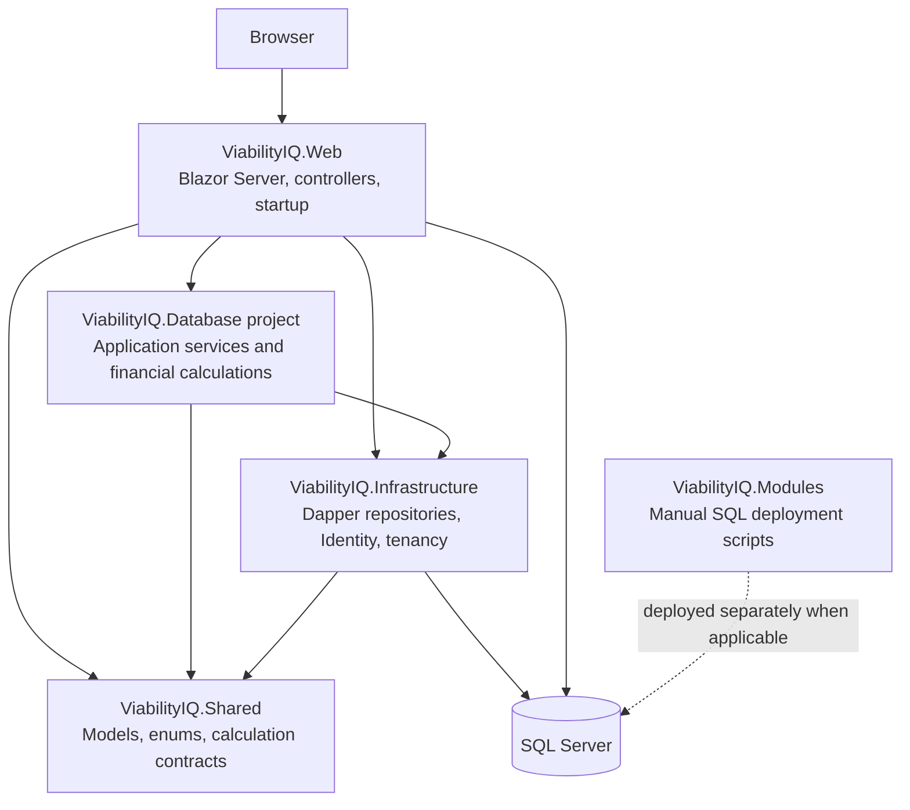

# ViabilityIQ Technical Maintenance Manual

This manual describes the application architecture and the practical rules for changing, building, deploying, and troubleshooting ViabilityIQ. It is intended for developers and maintainers, not end users.

The repository is the source of truth. Verify paths, schema, and behavior against the checked-out branch before applying a deployment instruction: SQL scripts and packaged updates can be branch- and release-specific.

## 1. System at a glance

ViabilityIQ is a .NET 8 web application built primarily as a Blazor Interactive Server application. It uses ASP.NET Core Identity for authentication, SQL Server for persistence, Dapper for most operational data access, and Entity Framework Core for Identity/application database migrations. Financial calculations are assembled by application services and performed by calculation services/engines.



## 2. Solution and project responsibilities

| Project/folder | Responsibility |
|---|---|
| `ViabilityIQ.Web` | Web host, Blazor pages/components, controllers, authentication wiring, startup checks, UI-facing services, and web middleware. |
| `ViabilityIQ.Infrastructure` | SQL connection factory, Dapper repositories, Identity contexts, tenant authorization/provisioning, operational reference allocation, and persistence-oriented services. |
| `ViabilityIQ.Database` | The solution project containing application services and financial calculation engines. Some namespaces use `ViabilityIQ.Application`; follow the project file and its existing namespace conventions. |
| `ViabilityIQ.Shared` | Data models, enums, contracts, financial input/output models, and shared application types. |
| `ViabilityIQ.Modules\Database_Sql` | Hand-authored SQL deployment and schema/data migration scripts. These are not interchangeable with EF Core migration files. |
| `GitHubCopilot_Trials` | Packaged or trial deliverables. These are not the main application source projects. Do not copy source files from a package into a component folder without checking for an existing component with the same class/namespace. |
| `ViabilityIQ.LeadsAPI` | A repository-level API project that is not currently listed as a project in `ViabilityIQ.sln`; check its project file and deployment use before treating it as part of the main application build. |

The solution targets .NET 8. There is no dedicated automated test project listed in the solution at the time this manual was written.

## 3. Application startup and request pipeline

`ViabilityIQ.Web\Program.cs` is the composition root. It configures logging, dependency injection, middleware, controllers, Razor components, health checks, and startup database availability. Service-registration extensions keep groups of registrations in their owning projects:

- `ViabilityIQ.Web\Extensions\ApplicationExtensions.cs` configures SQL Server EF contexts, Identity, authentication, and web/application service registrations.
- `ViabilityIQ.Infrastructure\Extensions\ServiceCollectionExtensions.cs` registers infrastructure services, repositories, and tenant services.
- `ViabilityIQ.Database\ExtensionServices\ServiceCollectionExtensions.cs` registers financial calculation and reporting services.

The web pipeline is configured by `ApplicationBuilderExtensions`. Its ordering is important: exception handling and HTTPS/static-file handling precede authentication and authorization; antiforgery is enabled before mapping interactive Razor components. Controllers are mapped separately by startup, and `/health` is mapped by the application pipeline.

Startup calls `StartWithDatabaseAvailabilityAsync`: the HTTP host is started first, then EF migrations are applied to `IdentityDbContext` and `ApplicationDbContext`. Transient startup database failures are retried according to `DatabaseResilience` settings. If initialization ultimately fails, the host remains available with the database-unavailable status page rather than serving the application as ready.

**Operational SQL in `ViabilityIQ.Modules\Database_Sql` is a separate deployment path.** Do not assume a SQL script in that directory is executed by application startup. Follow the script/package instructions for the release and environment, back up production data, and verify the resulting schema before deploying code that depends on it.

## 4. Configuration and secrets

The Dapper connection factory reads:

- `ConnectionStrings:ViabilityIQ_Connection`
- `DatabaseResilience:ConnectionTimeoutSeconds`
- `DatabaseResilience:ConnectionRetryCount`
- `DatabaseResilience:ConnectionRetryIntervalSeconds`
- `DatabaseResilience:CommandTimeoutSeconds`

Database startup additionally reads `DatabaseResilience:StartupMaxAttempts` and `DatabaseResilience:StartupRetryDelaySeconds`. The connection factory applies safe defaults for invalid/non-positive resilience values, but the connection string itself is mandatory.

Supply environment-specific connection strings through a secret manager, deployment environment variables, or .NET User Secrets for local development. For environment variables, nested configuration keys use double underscores, for example `ConnectionStrings__ViabilityIQ_Connection`. Never commit credentials or paste production connection strings into documentation, source files, or issue reports. `appsettings*.json` should contain only non-secret defaults.

### GroqCloud sensitivity analysis

The Groq integration binds the `GroqSensitivityAI` configuration section to `GroqSensitivityAiOptions`. The web project has a `UserSecretsId` and `WebApplication.CreateBuilder` loads its User Secrets automatically when the environment is Development. `appsettings.Development.json` contains non-secret development defaults (enabled flag, HTTPS endpoint, model, timeout, and response limits); it must not contain `ApiKey`.

Set the local development API key in the user-secrets store. In Visual Studio, right-click `ViabilityIQ.Web` and choose **Manage User Secrets**, then add the key to the JSON file that opens outside the repository:

```json
{
  "GroqSensitivityAI": {
    "ApiKey": "enter-the-key-locally"
  }
}
```

Save the file and restart the Development app. User Secrets are loaded automatically because the web project has a `UserSecretsId`; do not commit the secrets file or paste the key into chat, tickets, screenshots, source files, `appsettings*.json`, or shell history. Avoid `dotnet user-secrets list` in captured sessions because it prints secret values. Remove a key with `dotnet user-secrets remove "GroqSensitivityAI:ApiKey" --project .\ViabilityIQ.Web\ViabilityIQ.Web.csproj`.

User Secrets are a local development convenience, not an encrypted production vault. For the test platform, inject the same settings through that host's secret/configuration facility, especially `GroqSensitivityAI:ApiKey`. Standard .NET environment variable names are `GroqSensitivityAI__Enabled`, `GroqSensitivityAI__Endpoint`, `GroqSensitivityAI__Model`, and `GroqSensitivityAI__ApiKey`; double underscores map to nested configuration keys. Enable the feature only in the intended environment, use the HTTPS Groq endpoint, and confirm the selected model is available for the API account. A newly provisioned host does not inherit local User Secrets.

The public test URL `https://www.viability-iq.co.za/` responds with `Microsoft-IIS/10.0` and `ASP.NET`, which indicates IIS hosting but does not identify the hosting provider or its control panel. On IIS, configure the Groq variables in the host's protected environment/secret configuration, or in the ASP.NET Core Module environment-variable settings for that application if the hosting administrator requires it. Do not commit a `web.config` containing the API key. Recycle the application pool/restart the site after changing process environment settings, and verify the running site's ASP.NET Core environment is `Staging` or the test environment name—not `Development`—so it cannot depend on developer User Secrets.

The Groq strict JSON Schema must stay within Groq's documented schema subset. Enforce list sizes and numeric ranges in `GroqSensitivityAiAnalysisService.Validate` rather than adding unsupported keywords such as `minItems`, `maxItems`, `minimum`, or `maximum` to the request schema; otherwise Groq may respond with HTTP 400. A 400 response logs a bounded provider error detail with the application correlation ID, without logging the request or authorization header.

Each Groq analysis attempt is also recorded in `dbo.tblActivityLog` as a `GroqSensitivityAI` activity. The audit metadata records the internal user, tenant and assessment scope, consent state/time, case type, provider/model, prompt and response-schema versions, outcome, correlation ID, elapsed time, HTTP status, token usage when returned by Groq, and the categories of data sent. It deliberately excludes API keys, raw prompts, financial values, model response text, client IP address, and user-agent. These audit records are retained indefinitely; no automatic purge is configured. If writing the audit record fails, the analysis page displays an audit warning and the server logs the failure.

### Support email configuration

Support tickets are persisted in SQL Server and then emailed to the recipient configured at `Support:EmailAddress`. The current default recipient is `zabron.muyambo@gmail.com`; set the value for each environment rather than relying on a source-controlled default. For example, configure `Support__EmailAddress` as an environment variable or store the key in the deployment secret/configuration provider.

Ticket delivery uses the shared `EmailReportingService` and requires all of these settings:

| Configuration key | Purpose |
|---|---|
| `EmailSettings:SmtpServer` | SMTP host name. |
| `EmailSettings:Port` | Numeric SMTP port from 1 to 65535. |
| `EmailSettings:SenderAddress` | Authenticated sender and message From address. |
| `EmailSettings:SenderPassword` | SMTP credential; store only in a secret manager or protected environment setting. |
| `EmailSettings:EnableSsl` | `true` or `false`, according to the SMTP provider's requirements. |
| `Support:EmailAddress` | Support centre recipient for ticket notifications. |

Use the corresponding environment-variable keys `EmailSettings__SmtpServer`, `EmailSettings__Port`, `EmailSettings__SenderAddress`, `EmailSettings__SenderPassword`, `EmailSettings__EnableSsl`, and `Support__EmailAddress` when configuring the host environment. Confirm the SMTP provider's port, TLS requirements, and sender authorization before production deployment. Never commit real SMTP credentials.

## 5. Persistence and data access

### Dapper operational repositories

`IDbConnectionFactory` creates SQL Server connections from the configured connection string. `GenericDataRepository<T>` is the common repository for operational entities; it uses Dapper/Dapper.Contrib for SQL and handles shared read/write concerns such as tenant scope, audit fields, validation of SQL identifiers, and activity logging. Entity table mappings and key conventions therefore matter: inspect the model attributes and repository behavior before renaming a model, property, table, or key.

The repository uses transactions for writes that have coupled effects, including assessment creation, reference allocation, validation, and activity logging. Preserve those transaction boundaries when adding dependent writes. Some specialized use cases have dedicated repositories; use the closest existing pattern rather than bypassing the repository layer from a UI component.

### Entity Framework Core

`IdentityDbContext` and `ApplicationDbContext` define the EF Identity schema/mappings and are migrated during startup. These contexts share SQL Server and map Identity records to the established `tbl...` table names. They are not a replacement for Dapper-based operational repositories.

When a model or schema change is made, determine which persistence path owns it. A CLR property alone does not add a column to an existing production database. EF migrations and manually maintained SQL scripts need to be updated and deployed through their respective mechanisms.

### Audit and active records

Operational models commonly implement `IAuditableEntity`; writes set created/modified user and UTC timestamps, and active state is used for soft deactivation. Tenant-scoped models commonly implement `ITenantEntity`. Preserve audit fields and active-record filtering when creating specialized queries or update paths.

## 6. Authentication, tenant context, and authorization

ASP.NET Core Identity authenticates users. `ISessionService` exposes the current authenticated user and active tenant context to application services and repositories, including membership, active assessment, and organizational assignment details.

The tenant model includes tenants, memberships, subscriptions, role codes, and scoped record grants. `TenantAuthorizationService` checks that the current user has an active membership and that tenant/subscription access is valid, then evaluates role permissions and record-level grants. Operational authorization supports both tenant-wide and scoped read/write/delete access. Assessment-specific grants must be honored where applicable.

The organization hierarchy includes tenant, company, region/province, and site/branch concepts. Some existing CLR/database names retain legacy terminology such as `Branch` and `Province`; the UI may present these as Site and Region. Do not rename legacy storage identifiers as a cosmetic change: SQL scripts, model mappings, generated code, and other consumers may depend on them.

**Security rule:** never rely on hiding a UI button as the authorization check. Enforce access in the service/repository path that reads or mutates the record. When adding an entity type or a special query, confirm that it cannot bypass tenant and assessment scope.

Support consultant access is a separate, global Identity role named `Support Consultant`, not a tenant membership role. `SupportRoleSeeder` ensures the role exists at startup after database initialization. Administrators with the global `Admin` role grant or remove it at `/admin/support-consultants`; consultants access support chats from the **Support Chats** tab within `/settings/notifications`. The tab is role-gated in the UI, and `SupportService` independently checks the role and assignment before consultant operations. A consultant may claim a waiting conversation; only its assigned consultant may reply or close it. Users may read and update only their own conversations in their active tenant. Role changes may not update an already-issued authentication principal immediately; have the affected staff member sign in again if access does not reflect the change.

## 7. Assessment lifecycle and operational references

Assessments are the parent scope for operational inputs and projections. The assessment model includes tenant and branch/site context; many financial inputs carry an `AssessmentId`. Repositories filter and validate access to the active operational scope.

Assessment case references are prepared and finalized by `OperationalReferenceService` as part of the repository write transaction. The current format is:

`VIQ-{SiteCode}-{BusinessCode}-{YY}/{Sequence}`

The sequence is allocated per site/branch and calendar year, with SQL Server transaction locking to avoid concurrent duplicate numbers. The business code is included in the rendered reference, but the sequence key is not per business. Keep the numbering allocation, unique constraints/schema, and any resequencing migration aligned when changing this behavior.

Assessments also persist `AssessmentModeId`, `ManufacturingInputMethodId`, `CountryCode`, `CurrencyCode`, and `CultureName`. Mode is selected at registration and is immutable on update so existing input values are not silently reinterpreted. Supported modes are Trading (1), Service (2), legacy Manufacturing Simplified (3), and Manufacturing (4). New Manufacturing assessments default to Monthly Estimates (`ManufacturingInputMethodId = 1`); BOM-based (2) and job-based (3) methods are documented as planned but are not selectable or accepted by persistence yet. Existing mode-3 assessments remain on their original simplified projection and must not be migrated to mode 4 without a reviewed conversion. `AssessmentLocaleOptions` derives the supported English locale/country/currency presets from .NET culture data. Use `DisplayUtility.FormatCurrency`, `FormatNumber`, and `FormatDate` for assessment displays, passing the active session's currency and culture; current assessment-aware formatting includes stock, assets, working capital, loans, core dashboards, and the assumptions report. The interface language remains English. Currency is a display designation only; no foreign-exchange conversion is performed.

## 8. Financial calculations and projections

The calculation flow generally follows this pattern:

1. A page or feature invokes an application service for an assessment.
2. The service loads active source records through repositories, often concurrently.
3. The service constructs a typed calculation input.
4. A calculator/engine computes results and warnings.
5. The result is returned to the UI/reporting layer; calculations should not be reimplemented in Razor markup.

For example, `CashflowProjectionService` loads assessment assumptions, sales/categories, stock, expenses, VAT, loans/repayments, asset movements, accounts, and depreciation. It passes these to `CashflowProjectionCalculator`, which builds twelve monthly cashflow results and warnings. `AccountsProjectionService`, VAT projection, and depreciation are separate calculation responsibilities.

Keep pure calculation logic deterministic and separate from I/O when extending it. Update the input record, service loading, calculator behavior, output model, and any report/UI consumers together. Review warning/alert behavior as well as numeric results; projections surface alerts for incomplete configuration and inconsistencies such as a projected stock shortfall.

### Stock and cost of sales

Stock projection is mode-specific:

- Trading: opening inventory is the sum of active stock-item opening balances; monthly item values are purchases/additions. Estimated cost of sales is deducted from available stock. Closing inventory carries forward; a negative projected balance is clamped to zero and a warning is generated.
- Service: stock and cost of goods sold are zero; service delivery and operating costs are captured through Sales and Expenses.
- Legacy Manufacturing Simplified (mode 3): each product's planned monthly units multiplied by its standard unit cost adds to finished-goods inventory. The existing sales/category markup or assessment cost-of-sales percentage estimates inventory consumption. Preserve this path for existing assessments; it is not the new Manufacturing method.
- Manufacturing (mode 4, Monthly Estimates): sales remain monthly revenue by sales category. The manufacturing inventory page lists existing active sales categories; categories are created in Sales, not in Manufacturing. Each category has Raw Materials, WIP, and Finished Products rows with month-end inventory values, a category total, and a grand total. Each row is edited in an off-canvas form. Raw materials are entered as separate items per category with opening quantity/value, monthly purchase quantity/value, and month-end quantity. The calculation derives weighted-average cost per unit, material consumption, and closing raw-material value. Production labour/overhead expense rows marked `IsDirectProductionCost` are added to production costs; raw-material purchases must not also be entered as expense rows. Monthly closing WIP and finished-goods values are entered per category as estimates. The cost flow is `completed production = opening WIP + materials consumed + production costs - closing WIP`, then `cost of sales = opening finished goods + completed production - closing finished goods`. These values aggregate across categories in the existing assessment-level projection. Closing balances carry forward by category. Negative or impossible material/WIP/finished-goods flows remain visible and produce projection alerts rather than being silently clamped. Raw-material purchases participate in accounts/creditor and VAT calculations; cash treatment follows the assessment's creditor profile or cash-purchase behavior. Expense rows still use `blSendToCashBook` for cash outflows, and VAT is calculated separately from inventory values.

Monthly Estimates do not require a BOM or job-level records. WIP and finished-goods closing values are user estimates, so the resulting projection is not a production ledger or statutory accounts. BOM-based and job-based workflows must be completed before enabling those method choices. Older manufacturing materials and balances may have a null sales-category link; the page surfaces these as unassigned legacy inputs, which should be reviewed and assigned through the relevant category editor. Changes to this flow require coordinated updates to cashflow, accounts/creditors, VAT, readiness, reports, migration scripts, and user guidance.

The required manual schema changes are `ViabilityIQ.Modules\Database_Sql\2026-10-17_AssessmentModesAndInternationalSettings.sql`, `ViabilityIQ.Modules\Database_Sql\2026-10-18_FullManufacturingMonthlyEstimates.sql`, and `ViabilityIQ.Modules\Database_Sql\2026-10-18_ManufacturingInventoryBySalesCategory.sql`, in that order. The second adds the assessment input-method field and manufacturing inventory tables; the third adds nullable sales-category links and category-scoped uniqueness for WIP/finished-goods balances while preserving unassigned legacy rows. Apply all scripts through the release's manual SQL deployment process before deploying code that reads or writes those columns; application startup does not run these scripts.

Trading assessments may optionally store month-end closing-stock estimates on the assessment. Apply `ViabilityIQ.Modules\Database_Sql\2026-11-07_TradingMonthlyClosingStock.sql` before deploying code that reads or writes the twelve nullable `ClosingStock_Month_n` fields. A null month continues to use the calculated closing stock from opening inventory, purchases, and estimated cost of sales; a supplied value overrides the projected balance-sheet stock for that month.

Projected equity is separated into opening share capital and opening retained earnings. Retained earnings roll forward by monthly projected profit before tax; the current model does not calculate income tax or model drawings/distributions and new capital contributions. Apply `ViabilityIQ.Modules\Database_Sql\2026-11-07_EquityRollforward.sql` before deploying code that reads or writes the two opening equity fields. A non-zero Balance Sheet balance check should be reviewed against the opening statements and the explicitly excluded equity/tax transactions; equity is no longer plugged to force the statement to balance.

New assessments use one expense row marked `IsDirectorWages` for combined director remuneration; readiness checks require this marker, while legacy assessment-level wage values remain a backward-compatible fallback. `IsDirectProductionCost` is exposed for Manufacturing and legacy Manufacturing Simplified; in mode 4 it classifies production labour/overhead, not material purchases. It is copied from the operational expense table into the expense-list view model when editing, because the legacy SQL view may not project the new column. Preserve that direct-table flag lookup unless the database view is explicitly migrated and verified.


### Projection cache

`ProjectionStateManager` maintains an in-memory cache and a dependency graph for selected projections, with explicit invalidation and change notifications. It is not durable storage. When changing a source value or adding a dependency, verify that writes trigger the corresponding invalidation; otherwise the UI can temporarily display stale cached results. Check the service lifetime in DI before changing the cache implementation or its thread-safety assumptions.

## 9. UI and component conventions

Blazor pages and reusable components live under `ViabilityIQ.Web\Components`. A Razor component can consist of a `.razor` markup file and a matching `.razor.cs` partial class; treat them as one component and keep one authoritative definition for each component type.

When seeing errors in generated files under `obj\...\RazorSourceGenerator`—for example duplicate `BuildRenderTree`, `TypeInference`, or `CreateValidationMessage` members—first inspect source files for duplicate `.razor` components, duplicate partial class declarations, or duplicate component namespaces. The generated `.g.cs` file is normally output, not the source fix. After fixing actual source duplication, clean and rebuild to regenerate Razor output.

Component parameters and event callbacks should follow the existing component patterns. Keep data access and calculation decisions in services, not code-behind event handlers, unless the behavior is strictly UI state.

### Support modules: design and operation

The support feature has two user-facing paths and a consultant workflow:

| Path | Entry point | Behavior |
|---|---|---|
| Interactive chat | **Chat with support** in the top bar of `MainLayout` and `MainLayout_Assessment` | Opens the shared chat component in each layout's off-canvas host. A user starts or resumes an open conversation and exchanges text messages with a consultant. |
| Email ticket | **Get Help** in the main layout's sidebar | Opens a form for a title, description, and optional files. The service stores the ticket, creates a reference such as `VIQ-SUPPORT-000123`, then sends an email notification and attachments to `Support:EmailAddress`. |
| Consultant inbox | **Support Chats** tab in `/settings/notifications` (visible to Support Consultants) | Reuses the existing Communications page and its message records. Claiming a waiting conversation atomically assigns it and inserts the personalized greeting. |
| Consultant access | `/admin/support-consultants` | Global-Admin-only page for granting/removing the Support Consultant role. |

`ISupportService` is the application-facing contract in `ViabilityIQ.Database\Interfaces\ISupportService.cs`; `SupportService` in Infrastructure owns SQL access, state transitions, access checks, ticket validation, and email dispatch. `SupportModels.cs` contains the conversation, message, ticket-request, attachment, and result models. Infrastructure DI registers `ISupportService`; Web DI registers the hosted conversation-expiry service. The UI components should call the service rather than query the support tables directly.

`SupportConversations` holds tenant-scoped conversation state, assigned consultant, timestamps, and a last-message preview. Chat text is stored in the existing `dbo.tblNotificationItem` communications table using support-specific conversation, sender-name, and message-type fields; it therefore shares the established message persistence rather than introducing a separate message table. Normal direct-message and task lists exclude support chat records, while the Support Chats tab displays the linked thread. `SupportTickets` stores the issue content and email-delivery timestamp. Conversation claim and greeting insertion are transactional. Ticket creation commits before email dispatch: if SMTP configuration or delivery fails, the ticket remains stored, the result reports that its notification was not sent, and `EmailSentAtUtc` remains null. Attachments are sent with the notification and are **not** persisted in the support-ticket tables; support teams must treat the email as the attachment record. If an earlier package created `dbo.SupportMessages`, the integration migration copies its history idempotently into the existing communications table; the old table is left in place and is no longer used by the application.

Chat message bodies are limited to 4,000 characters; ticket titles are limited to 160 characters and descriptions to 10,000 characters. Ticket attachments allow `.pdf`, `.doc`, `.docx`, `.xls`, `.xlsx`, `.csv`, `.txt`, `.png`, `.jpg`, `.jpeg`, and `.zip`, with at most five files, 10 MB per file, and 25 MB combined. The server validates these limits and derives email MIME types from the allowed filename extension. Keep client-side upload limits aligned with `SupportService` server-side validation.

The user chat refreshes every 4 seconds and the consultant inbox every 5 seconds. `SupportConversationExpiryService` runs once per minute and expires open conversations whose `LastUserActivityAtUtc` is at least 10 minutes old; service reads and writes also enforce expiry. The timeout is based on the last recorded user message, not browser mouse/keyboard presence. If changing the idle policy or polling cadence, update the service, expiry worker, UI status text, and this manual together. The hosted expiry worker and polling are process-local; in a multi-instance deployment, each instance may run the expiry sweep, so keep the database update idempotent.

#### Configuration and deployment

1. Apply `ViabilityIQ.Modules\Database_Sql\2026-11-08_SupportModules.sql` to the target database before deploying the support code. It creates `SupportConversations` and `SupportTickets` and the indexes used by the inbox and expiry queries.
2. Apply `ViabilityIQ.Modules\Database_Sql\2026-11-08_SupportMessagingIntegration.sql`. It requires the existing `dbo.tblNotificationItem` table and the support conversation table, then adds thread metadata and the support-message index. This separate additive script supports both new installations and databases where the earlier support schema script was already applied. Application startup does not apply either script.
3. Set `Support:EmailAddress` for the environment and configure all five `EmailSettings` SMTP keys described in Section 4. Protect SMTP credentials and use a sender address authorized by the SMTP provider.
4. Ensure the application identity has SQL permissions to read/write the three support tables and support-tagged rows in `dbo.tblNotificationItem`; the scripts themselves are intended to be run by the database deployment operator with schema permissions.
5. Start the application after both scripts have succeeded. Startup seeds the Support Consultant role; an administrator then assigns that role to staff through `/admin/support-consultants`.
6. Test using a development database and mail endpoint: create a chat, claim it as a consultant from the Support Chats tab in Notifications & Messaging, verify the greeting and replies, verify the 10-minute expiry boundary, submit a ticket with multiple allowed files, and verify both stored ticket data and successful SMTP delivery.

Keep the SQL script in the manual SQL deployment track and include it in release notes/manifests with the matching application version. Do not edit the database schema manually in production without updating the script and release documentation.

## 10. Database changes and release practice

Before changing a schema:

1. Identify the owning model, table, and persistence mechanism (EF Core migration, manual SQL script, or both).
2. Check existing SQL naming, nullability, defaults, foreign keys, indexes, and tenant/assessment scoping.
3. Make the migration safe to run in the target deployment context. SQL Server scripts with statements that depend on a newly added column may need a batch boundary such as `GO`, because SQL Server can resolve column names before executing the preceding `ALTER TABLE`.
4. Consider existing data and repeat/partial execution. Use explicit preconditions and transactions for data migrations when appropriate; do not rely on a code deploy to silently repair a manually managed schema.
5. Update deployment instructions and any packaged manifest/checksum that accompanies the change.
6. Validate the script against a disposable database or a restored backup before production. Confirm the resulting schema and representative data after execution.

For production deployments, coordinate the order of database and application changes. Do not apply a script to a user database from an unreviewed branch. Keep a rollback/restore plan for data migrations; a transaction does not substitute for a backup.

## 11. Build, run, and validation

From the repository root in PowerShell:

```powershell
dotnet restore .\ViabilityIQ.sln
dotnet build .\ViabilityIQ.sln --no-restore
dotnet run --project .\ViabilityIQ.Web\ViabilityIQ.Web.csproj
```

The app requires a configured SQL Server connection and a database compatible with the checked-out code. A successful compile does not verify that a deployed database contains every required operational SQL change.

No dedicated automated test project is currently listed in the solution. For calculation changes, add or run focused tests if a test project exists in the target branch; otherwise validate representative inputs/outputs using a safe development database and document the scenario. Also run the solution build after Razor or shared-model changes because a compile error may appear in generated Razor code or another project.

## 12. Logging, health, and troubleshooting

Serilog is configured at the web host, and application services use `ILogger<T>` for structured logging. Prefer structured properties (for example, assessment ID and error reference) over concatenated messages. Do not log passwords, connection strings, tokens, or sensitive financial data. Startup and database availability behavior is implemented in `DatabaseInitializationExtension` and the startup-status middleware.

| Symptom | Likely area to inspect |
|---|---|
| `Invalid column name ...` | Code/schema version mismatch, missing or unapplied manual SQL script, wrong database, or a script that partially ran. Check the exact database selected by the connection string and the release's migration instructions. |
| Duplicate Razor-generated members or ambiguous component tag | Search source directories for duplicate `.razor` files, code-behind partials, or same-named components/namespaces. Fix source duplication, then clean/rebuild; do not hand-edit generated `obj` files. |
| Tenant user cannot see/update a record | Check active membership/subscription, role permissions, record grants, tenant ID, and assessment/site scope. Review both the UI selection and authorization/repository query. |
| Assessment save fails while allocating a reference | Check active membership's default site/branch, active Business and Site codes, case-sequence table/schema, SQL transaction errors, and sequence locks. |
| Projection appears stale | Check whether the source write invalidates dependent cached calculations and whether the UI subscribes to projection change notifications. |
| Application starts but shows database unavailable | Check startup logs and error reference, SQL connectivity/permissions, both EF migration states, and whether the manually deployed operational schema matches the application version. |
| Support screens fail with missing-table or invalid-column errors | Apply and verify both `2026-11-08_SupportModules.sql` and `2026-11-08_SupportMessagingIntegration.sql` against the database selected by the web application's connection string. |
| Support ticket is recorded but no email arrives | Check the ticket's `EmailSentAtUtc`, `Support:EmailAddress`, all `EmailSettings` SMTP values, sender authorization, SMTP/TLS settings, and structured email-delivery logs. A stored ticket with a null email timestamp needs notification follow-up; retry behavior is not automatic. |
| Consultant cannot access the inbox after role assignment | Confirm the global `Support Consultant` role assignment and have the staff member sign out and back in to refresh the Identity principal. |
| Chat expires earlier/later than expected | Check `LastUserActivityAtUtc` and the 10-minute timeout in `SupportService`; timeout is measured from the last recorded user message, with the background sweep running once per minute. |

Use `/health` for the mapped health endpoint. It does not replace verifying database readiness or the correctness of manually managed operational schema.

## 13. Maintenance checklist

Before merging a change, confirm:

- All affected projects and consumers have been updated, including UI, calculation input/output, reports, and SQL schema where relevant.
- Authorization and tenant/assessment filtering apply to every read and write path.
- Audit fields, active status, transactions, and reference allocation semantics are preserved.
- Database migration instructions match the code and handle existing records safely.
- No secrets or environment-specific connection strings are included.
- The solution builds and relevant calculation or deployment scenarios have been validated.
- New or changed component types exist only once in their intended namespaces.
